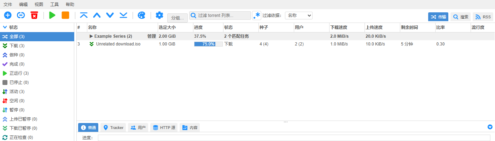
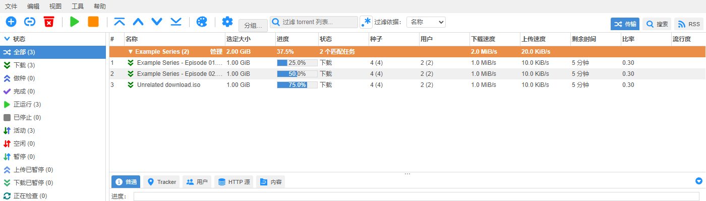

# Manual transfer groups

Select torrents with Ctrl/Cmd or Shift, choose **Group…**, and enter a name.
Entering an existing name adds the selected torrents to that group. Membership
does not depend on save paths. **Remove from group** affects the selection;
**Manage** on a group header renames/merges or dissolves the entire group.

Groups start collapsed. Expand a group to select individual torrents for normal
torrent actions. Collapsing clears hidden selections. Group headers are display
rows, never torrent IDs. Filtering happens before grouping, so counts, size,
weighted progress and speeds summarize matching members only. Sorting places a
group at its first matching member and preserves the member sort order.

Membership uses the existing authenticated clientdata API, one
`qbt_manual_group_<torrent hash>` key per torrent. Writes affect only the selected
keys. An unsuccessful write leaves local membership unchanged. Visible clients
refresh group data every ten seconds. Concurrent edits of different torrents do
not overwrite each other; concurrent edits of the same torrent use last-write
wins. Expansion is local to the page, not shared. Removed torrent keys are not
automatically pruned, so readding the same torrent restores membership. The
existing clientdata size limit applies.

## Validation

Run `npm test` in `src/webui/www`. The added tests cover cross-path grouping,
filtering, sorted expansion, selected-key persistence, and failed writes.

Browser regression checklist (test with virtual lists both off and on):

1. Select two torrents in different folders, create a named group, expand it.
2. Select a member, collapse the group, then select all. Hidden members and
   headers must not be selected. Right-clicking a header must not select it.
3. Add another torrent by entering the same group name. Reload, then open an
   independent browser context; membership should remain present.
4. Filter to a single member, then clear the filter. Counts should follow it.
5. Rename a group to text containing HTML markup. Render it as plain text.
6. Scroll through the virtual list and back. Expand and manage the group using
   actual pointer input; controls must survive redraws.
7. Reject a clientdata store request (for example HTTP 409). Keep the dialog and
   membership, show the error, then allow a retry.
8. Dissolve the group. Verify torrent count, paths, categories and tags remain
   unchanged.

Validated with the 5.2.4.10 backend and a 1,094-torrent session, Chromium automation
and a Windows 360ChromeX manual UI check. The deployed WebUI was also exercised
with real clientdata writes, reload and an independent browser context. This is
functional regression coverage and short live observation, not a long-duration
soak test. No C++ rebuild is required for alternative-WebUI validation.

The screenshots below use synthetic fixture torrents, not a user's library.

