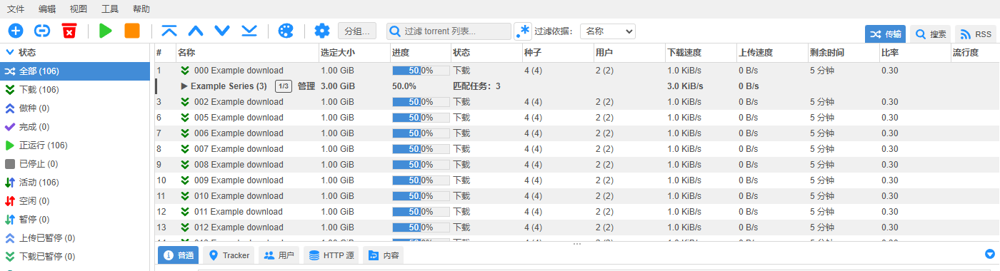
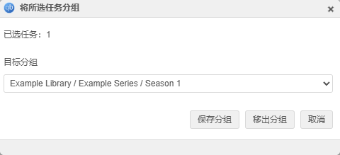
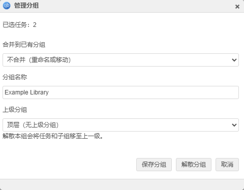

# Manual transfer groups

Select torrents with Ctrl/Cmd or Shift, choose **Group…**, and select an existing
destination from the list. Full paths distinguish subgroups with the same name.
Choose **Create new group…** to enter a new name and select its parent.
Membership does not depend on save paths. **Remove from group** affects the selection;
**Manage** on a group header changes its name or parent, moving the whole
subtree. Choose **Top level** to move it out. A group cannot be moved into itself
or its descendants. **Merge into an existing group** selects a merge destination
without typing its name. Dissolving removes only that level: direct torrents and
child groups move up to the parent, and deeper structure is retained.

Groups start collapsed and expand independently at each level. Collapsing retains
selected descendants. Ctrl/Cmd+A selects all matching torrents, including those
inside collapsed groups. Shift selects a range in grouped visual order, including
collapsed descendants and all members of a group used as either endpoint.
Repeated Shift selection keeps the original anchor; Ctrl/Cmd+Shift adds a range.
Ctrl/Cmd-click a group name to toggle its matching descendants without expanding;
click another header cell to select the group. An unmodified name click expands
or collapses it. Selected headers show a selected/total badge, with a partial
indicator when only some descendants are selected. Expand a group to select
individual torrents. All actions receive torrent hashes, never header IDs.
Filtering happens before grouping, so selection, counts, size,
weighted progress and speeds summarize matching members only. Sorting places a
group at its first matching member and preserves the member sort order.

Membership uses the existing authenticated clientdata API, one
`qbt_manual_group_<torrent hash>` key per torrent. A top-level name remains a
string, preserving existing groups (including literal slashes in names). Nested
memberships are arrays of path segments; ancestors are derived from those paths.
No automatic rewrite of existing data occurs. Writes update the selection or
whole moved subtree in one atomic clientdata store request. Group paths have a
maximum depth of 32. Empty groups disappear when they have no descendant tasks.
An unsuccessful write leaves local membership unchanged. Visible clients
refresh group data every ten seconds. Concurrent edits of different torrents do
not overwrite each other; concurrent edits of the same torrent use last-write
wins. Expansion is local to the page, not shared. Removed torrent keys are not
automatically pruned, so readding the same torrent restores membership. The
existing clientdata size limit applies.

The form uses the shared MochaUI modal with its standard title bar, close control,
theme and viewport limits. It resizes when switching between an existing group
and a new name. Escape cancels; form shortcuts cannot trigger torrent actions.

All messages use the existing WebUI translation pipeline. Catalogs are included
for English (including AU/GB), Simplified Chinese, Traditional Chinese (TW/HK),
Japanese, Korean, German, French, Spanish, Brazilian Portuguese and Russian.
Missing translations use the normal English fallback. Counts use complete
messages with `%1`, allowing translations to place the number appropriately.

## Validation

Run `npm test` in `src/webui/www`. The added tests cover cross-path grouping,
filtering, sorted expansion, selected-key persistence, failed writes, legacy
names, multilevel moves, merges, promotion on dissolve, cycle rejection and depth
limits, direct destination selection, modal keyboard handling and translation
coverage/placeholders, collapsed selection, group range endpoints, persistent
anchors, filter boundaries and recycled row selection styles.

Browser regression checklist (test with virtual lists both off and on):

1. Select two torrents in different folders, create a named group, expand it.
2. Select a member, collapse the group, then select all. All matching hidden
   members must be selected exactly once; synthetic header IDs must never reach
   torrent actions. Expand again and check the selected row styling. Test Shift
   ranges across groups in both directions, repeated Shift changes, group
   endpoints, Ctrl/Cmd toggles and partial-selection badges. Intercept a batch
   action request and verify its hashes without changing real transfers.
3. Add another torrent by selecting an existing subgroup without typing. Reload, then open an
   independent browser context; membership should remain present.
4. Filter to a single member, then clear the filter. Counts should follow it.
5. Rename a group to text containing HTML markup. Render it as plain text.
6. Scroll through the virtual list and back. Expand and manage the group using
   actual pointer input; controls must survive redraws.
7. Reject a clientdata store request (for example HTTP 409). Keep the dialog and
   membership, show the error, then allow a retry.
8. Move a group containing subgroups into another group, then out to the top
   level. Reject self/descendant targets. Merge into an existing sibling group.
9. Dissolve an intermediate group; promote its tasks and child groups one level.
   Verify torrent count, paths, categories and tags remain unchanged.
10. Confirm the Group button is 24px high and vertically aligned with the
    neighboring toolbar icon (tested center-line difference: 0px).
11. Switch between existing/new destinations and merge/rename modes. Confirm
    the native window fits the form, including on narrow screens. Escape and
    the title-bar close button should cancel without writing memberships.
12. Check every included locale, plus an untranslated locale's English fallback.

Validated with the 5.2.4.10 backend and a 1,094-torrent session. All 26 unit tests
pass. Chromium automation covers nested groups in normal and virtual lists; the
initial single-level version also received a Windows 360ChromeX manual UI check.
The deployed nested WebUI was exercised with real clientdata writes, reload and
an independent browser context, preserving all 86 existing memberships and all
torrent paths, categories and tags. This is functional regression coverage and
short live observation, not a long-duration soak test. No C++ rebuild is required
for alternative-WebUI validation.

Collapsed-selection regression checks cover real keyboard and pointer input in
both list modes, including virtual scrolling and selected styles after expanding.
A 106-torrent synthetic fixture verifies intercepted batch-action hashes. Live
checks selected all 1,094 torrents and a 681-torrent range between collapsed
groups, with no JavaScript errors during 30 seconds of observation. All 997
current memberships and torrent paths, categories and tags were preserved;
deploying the alternative WebUI did not restart the download service.

Browser localization checks cover all 13 included locales and an untranslated
locale, using each locale's preferences and catalog. The current unrecompiled
backend predates these messages, so the local deployment adapter supplies only
this module's translations from the TS catalogs. Standard WebUI messages remain
under the backend translator; the PR uses QBT_TR and the normal build pipeline.

The screenshots below use synthetic fixture torrents, not a user's library.

